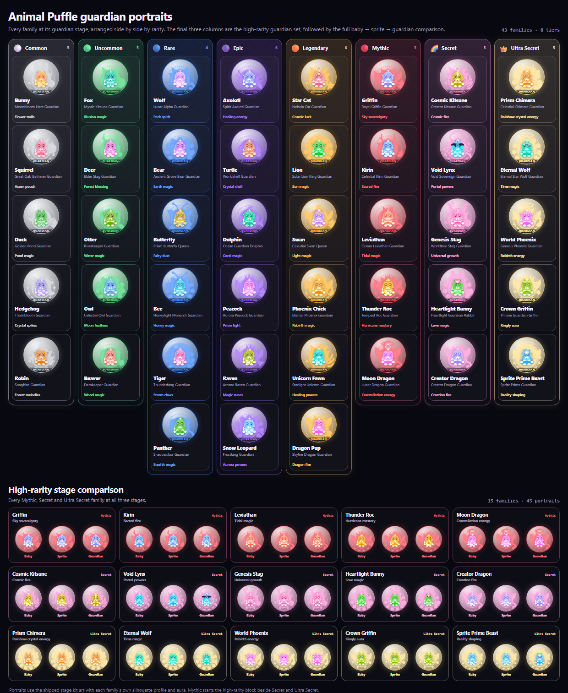
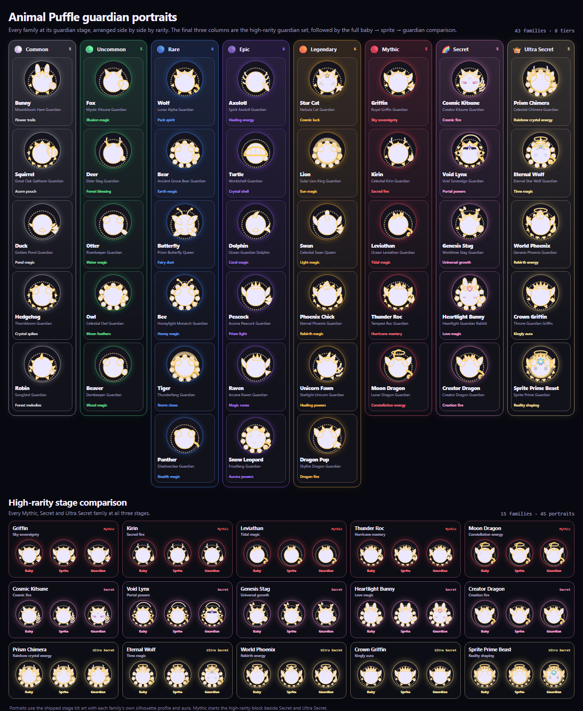

# Animal Puffle art reference

The Animal Puffle Encyclopedia contains **43 families across eight rarity tiers**.
Every family is a three-stage line: baby, sprite, and guardian. The guardian
portrait is the family's reference portrait, drawn on the same round puffle body
the live game renders, tinted to the family's hue and framed by that family's
own animal shape. Feature shapes are authored in the silhouette's 64-unit space
and mapped onto the body, so the outline and the painted portrait cannot drift
apart.

## Eight-tier guardian contact sheet



The sheet reads left to right in tier order: Common, Uncommon, Rare, Epic,
Legendary, Mythic, Secret, and Ultra Secret. The final three columns form the
high-rarity guardian block. Below it, the high-rarity stage comparison shows
all 15 Mythic, Secret, and Ultra Secret families at baby, sprite, and guardian.

## Silhouette audit



Every guardian uses the shared round puffball base. Identity comes from the
painted fringe plus the ears, crest, wings, tail, halo, and other appendages
around that base. The silhouette render above removes the painted body so the
outline can be compared directly, and the high-rarity comparison repeats that
outline behind the baby, sprite, and guardian portraits.

| Tier | Families |
| --- | ---: |
| Common | 5 |
| Uncommon | 5 |
| Rare | 6 |
| Epic | 6 |
| Legendary | 6 |
| Mythic | 5 |
| Secret | 5 |
| Ultra Secret | 5 |
| **Total** | **43** |

### Duplicate check

All 43 families have a silhouette profile, and no two profiles produce the same
rendered outline. The closest pairs differ by one visible feature:

| Pair | Difference |
| --- | --- |
| Griffin / Crown Griffin | Crown Griffin adds the crown crest. |
| Phoenix Chick / World Phoenix | World Phoenix adds the halo ring. |
| Tiger / Lion | Thin tiger tail versus tufted lion tail. |
| Beaver / Panther / Otter | Flat, thin, and thick tails respectively. |
| Wolf / Star Cat / Cosmic Kitsune | Curled wolf tail, star cat tail, and nine-tail fan. |

The same-kit high-rarity pairs are separated by body and appendage, not hue:

| Pair | Difference |
| --- | --- |
| Creator Dragon / Sprite Prime Beast | Tall, smooth, horned serpent versus wide, spiky, crown-maned beast with a halo. |
| Cosmic Kitsune / Eternal Wolf | Nine-tail fan and fox ears versus star-crested wolf tufts and a curled tail. |
| Prism Chimera / Crown Griffin | Dragon-winged antlered chimera versus crown-crested griffin with a tufted lion tail. |

The six cosmic families are told apart by shape alone, since the portraits share
one painted face: Star Cat, Cosmic Kitsune, Void Lynx, Heartlight Bunny, Eternal
Wolf, and Sprite Prime each carry their own ears, crest and tail.

## Rebuilding the sheets

The source harness is [`tools/animal-puffle-tier-contact.html`](../../../tools/animal-puffle-tier-contact.html).
Serve the repository root locally and open:

```text
http://127.0.0.1:8137/tools/animal-puffle-tier-contact.html
```

Append `?sil` to hide the painted portraits and render the silhouette pass. Both sheets
read the same `ANIMAL_PUFFLE_FAMILIES`, `ANIMAL_PUFFLE_SILHOUETTES`,
`apGuardianPortrait()`, and `apStagePortrait()` data used by the in-game
encyclopedia.
